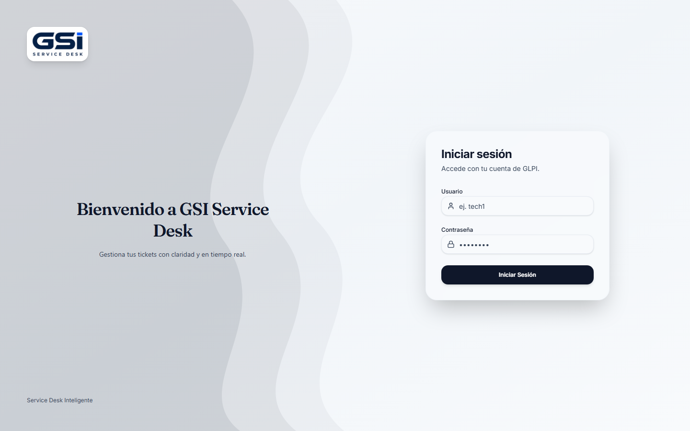
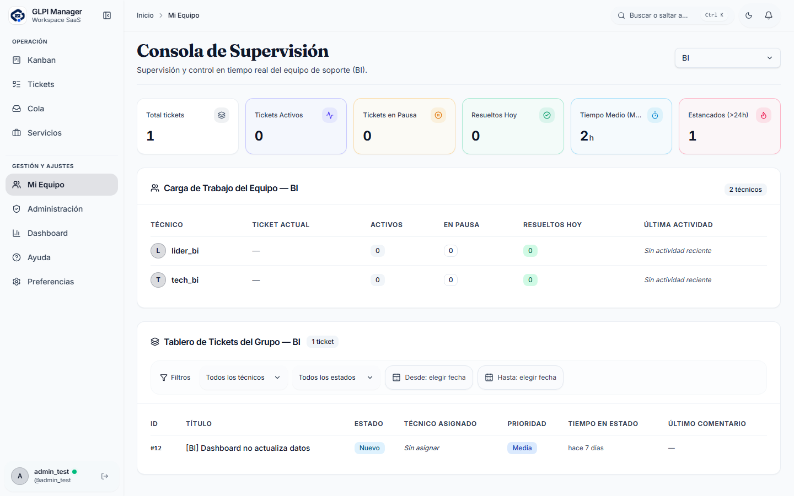
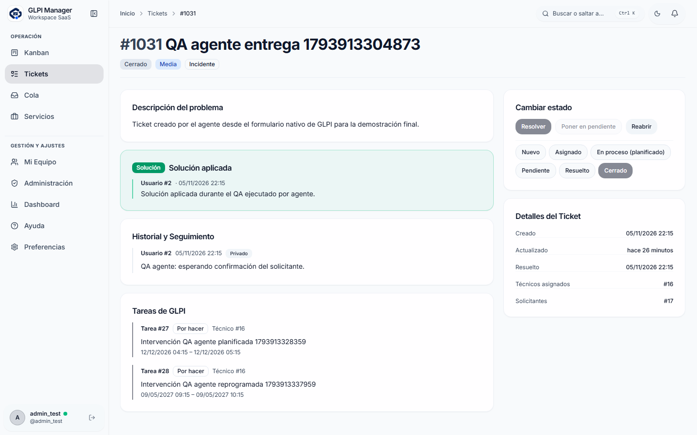
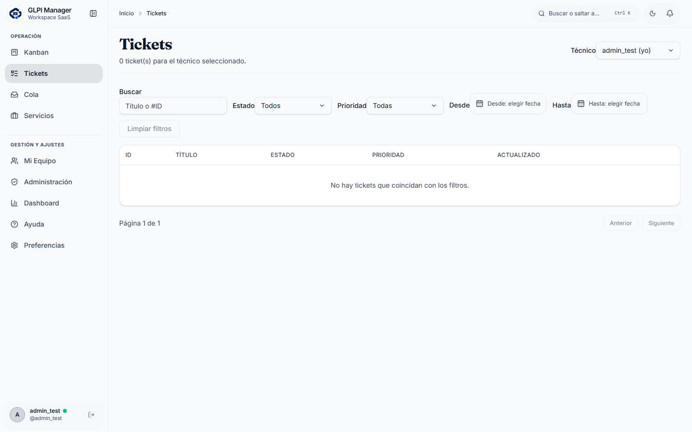
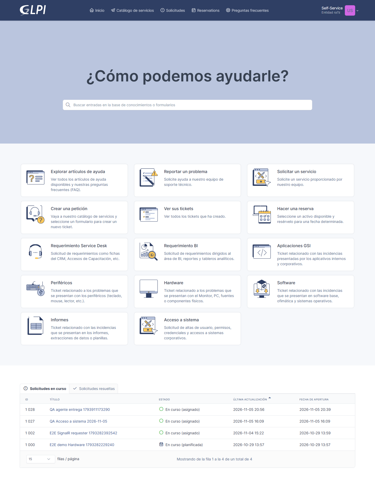

# Guía de demostración para el jefe — GLPI Ticket Manager

> Duración sugerida: 10–15 minutos. Todo lo descrito se ejecutó realmente en la QA automatizada del 2026-11-05; las capturas de esta guía provienen de esa ejecución.
> Alcance: red local del dueño (LAN). No es una URL pública de Internet.

## Antes de empezar

1. Conéctate a la misma red local del equipo donde corre el sistema.
2. Abre **http://10.10.40.31** en Chrome o Edge. Usa HTTP para la demo: la versión HTTPS funciona (200) pero muestra advertencia de certificado autofirmado y el navegador bloquea el service worker si la CA no está instalada.
3. Ten a mano el archivo privado `ENTREGA_JEFE_PRIVADO.txt` (contraseñas individuales). No se comparte por Git.

| Cuenta | Perfil | Dónde aterriza |
| --- | --- | --- |
| `admin_test` | Administrador | Kanban completo |
| `lider_sd` / `lider_dev` / `lider_bi` | Supervisor de grupo | Kanban + Mi Equipo |
| `tech_sd` / `tech_dev` / `tech_bi` | Técnico de grupo | Kanban de su grupo |
| `user_test` | Solicitante | Mis tickets |

*Captura real: sesión limpia. Cualquier ruta protegida redirige a `/login`.*

## Recorrido recomendado

### 1. Entra como administrador

Inicia sesión con `admin_test`. Aterrizas en el Kanban con las cinco columnas del ciclo de vida GLPI: Nuevo, Asignado, En proceso (planificado), Pendiente y Resuelto.

*Captura real: panel de equipo con métricas por grupo y contadores.*

### 2. Revisa el panel de equipo

Abre **Mi Equipo**. Verás el total de tickets y la carga por grupo. Este contador se actualiza en vivo: en la QA cambió de 8 a 9 al crearse un ticket, sin recargar la página.

### 3. Revisa el historial de un ticket real

Abre un ticket cerrado (por ejemplo `#1031`). Comprueba que conserva solución, seguimiento y las tareas reales de GLPI, incluso después de salir del Kanban activo.

*Captura real: ticket #1031 cerrado, con solución aplicada y dos `TicketTask` reales.*

### 4. Vive el tiempo real (dos ventanas)

1. Deja una ventana con el Kanban de `tech_sd`.
2. En otra ventana (o en el móvil), entra a **http://10.10.40.31:8081** como `user_test` y crea una incidencia desde el formulario nativo de GLPI, categoría **Hardware**.
3. Vuelve al Kanban sin recargar: la tarjeta aparece sola y se enruta a Service Desk.
4. Como técnico, asígnala y planifícala. El estado GLPI pasa a 2 y luego a 3 con una tarea real; la tarjeta se mueve en la otra ventana sin refrescar.
5. Ponla en pendiente y reanúdala: la columna cambia y la planificación se regenera.
6. Aplaza una solución: GLPI pasa a 5 y **no** se cierra solo.
7. Cierra el ticket desde GLPI (ventana de GLPI, no del Ticket Manager). La tarjeta desaparece del Kanban abierto en 548 ms y el ticket sigue consultable en el historial.

> Regla de producto: los tickets se crean **exclusivamente en GLPI**. La interfaz del Ticket Manager no tiene botón de alta; esto es intencional y está verificado por la suite E2E.

### 5. Comprueba el aislamiento

1. Cierra sesión y entra como `user_test`: solo ve sus tickets y no tiene acceso a Kanban ni Administración.
2. Entra como `tech_bi`: su Kanban es el del grupo BI. Aunque se manipule el identificador de grupo en la petición, no obtiene datos de Desarrollo ni de Service Desk.
3. Entra como `lider_sd`: ve la cola y las métricas de su grupo.

### 6. Experiencia móvil

Abre **http://10.10.40.31** en el móvil dentro de la LAN. El Kanban distingue claramente «Asignado» y «En proceso (planificado)»; la navegación y el detalle son utilizables en pantalla pequeña.

## Qué está verificado y qué no

| Elemento | Estado |
| --- | --- |
| Login de las 8 cuentas y redirección por rol | ✅ Verificado |
| Kanban, cola de grupo, detalle, historial, ayuda | ✅ Verificado |
| Tiempo real: alta, asignación, planificación, pausa, reanudación, cierre desde GLPI | ✅ Verificado (548 ms en el cierre) |
| Aislamiento entre grupos y roles | ✅ Verificado, incluida manipulación de parámetros |
| Manifiesto PWA e iconos | ✅ Verificado |
| Service worker en contexto seguro | ✅ Verificado en loopback |
| Service worker en HTTPS LAN | ⚠️ Bloqueado por CA autofirmada no instalada |
| Notificación push a nivel de sistema operativo | ⚠️ NOT_VERIFIED: requiere permiso de notificaciones y dispositivo/PWA instalada |

## Si algo no responde

1. Comprueba que estás en la red local y que usas `http://10.10.40.31` (no `localhost`).
2. Verifica los servicios: `docker ps` debe mostrar `glpi-api`, `glpi-frontend`, `glpi-lan-frontend`, `glpi`, `glpi-db` y `glpi-app-db` en estado `Up`.
3. Salud de la API: http://10.10.40.31/api/health y http://10.10.40.31/api/health/ready deben devolver 200.
4. El procedimiento completo de reinicio y rollback está en [`RUNBOOK_DESPLIEGUE_Y_ROLLBACK.md`](RUNBOOK_DESPLIEGUE_Y_ROLLBACK.md).

## Evidencia de esta guía

Capturas tomadas por la simulación automatizada en sesión limpia:
`docs/qa/evidence-20261105/boss-sim/` y `scratch/final-qa/artifacts/boss-sim-2026-11-05T21-41-44-430Z/` (12/12 PASS).

*Captura real: listado de tickets accesible para administración.*

*Captura real: GLPI original operativo en `:8081` con `user_test`.*
