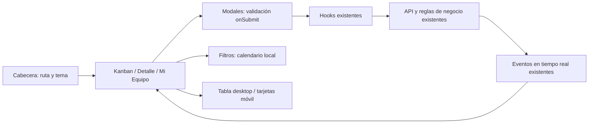

# ADR-024 — Pulido final UX/UI H-64

> **Control documental ISO 9001**
> **Código:** DOC-01-ADR-024 | **Versión:** 1.0.0 | **Fecha:** 2026-10-28
> **Autor:** Codex | **Revisión:** Codex (revisión del diff y QA) | **Estado:** implementado y validado; 40/40 E2E, typecheck/build y smoke de Nginx aprobados

## Contexto y alcance

La interfaz acumulaba contenido promocional en login, navegación repetida, validación anticipada y controles incómodos en móvil. H-64 consolida su presentación. Se conservan endpoints, payloads, roles, permisos, transiciones de estado y criterios de filtrado. El control documental identifica versión y revisión; no acredita certificación ISO ni sustituye evidencias.

## Decisiones

### Identidad y acceso

El título pasa a «GLPI Ticket Manager». El favicon reutiliza el isotipo GSI disponible mediante el alias público `isotipo-gsi.png`. Login mantiene logo arriba a la izquierda y olas más sutiles; retira el bloque promocional grande para centrar la atención en el formulario. La autenticación permanece intacta.

### Navegación y tema

El breadcrumb vive en la cabecera de `AppLayout`; `PageHeader` conserva el H1 sin duplicarlo. La cabecera ofrece un único botón Sol/Luna y retira el dropdown de presets, conservando alternancia y persistencia existentes.

### Modales y validación

Pendiente, Resolver y Reapertura usan React Hook Form con `mode: 'onSubmit'`. Foco y blur no activan mensajes rojos. Confirmar un formulario inválido muestra errores vinculados a los campos e impide la mutación; tras ese intento se permite revalidar al corregir. El ciclo de cierre limpia errores para evitar mensajes prematuros al reabrir.

Se preservan las reglas: Pendiente exige motivo y comentario no vacío; Resolver necesita solución no vacía y admite «OK»; Reapertura conserva motivo opcional de hasta 500 caracteres y retorno a Asignado. También se conservan manejo de errores API, prevención de doble envío, carga y restricciones de cierre durante resolución.

Los modales adoptan `rounded-2xl`, `bg-card`, campos `bg-background/50` y acciones a la derecha mediante tokens existentes.

### Filtros y calendario

Mi Equipo agrupa filtros en una barra `flex-wrap`, con separación uniforme, fondo tenue y esquinas redondeadas. Un calendario custom reemplaza los campos nativos de fecha de este tablero para lograr presentación consistente. Usa tokens popover, límites de rango y teclado. Mantiene valores locales `YYYY-MM-DD` que consume el filtro existente, sin cambiar consultas ni comparaciones de negocio.

Debe cerrar con Escape o clic externo, mostrar foco y evitar recortes del viewport. La responsabilidad adicional de accesibilidad se cubre con escenarios específicos en el manual QA.

### Tickets de equipo y notificaciones

El tablero conserva tabla desde `md` (768 px en la configuración actual) y muestra tarjetas de ancho completo por debajo. Ambas representaciones consumen la misma colección filtrada y muestran ID, título, estado y técnico. Las tarjetas ofrecen acceso al detalle con área táctil amplia sin duplicar llamadas de negocio.

El panel de notificaciones limita su ancho al viewport, utiliza fondo card translúcido y padding cómodo, y distingue lo no leído. Consulta, marcado y eventos en tiempo real conservan sus contratos.

## Consecuencias y validación

Se reduce contenido simultáneo y se adapta la densidad a móvil. Mantener tabla y tarjetas requiere reflejar en ambas futuras ampliaciones relevantes. El calendario custom requiere revisar teclado, foco, límites y posición en diferentes tamaños.

La aceptación se define en el [manual QA H-64](../qa/manual-pruebas.md): typecheck, build, Playwright y revisión visual. El objetivo 40/40 es criterio de entrega; este ADR no afirma ejecución ni aprobación. Registrar resultados y capturas solo tras obtener evidencia. GitNexus analiza impacto antes de editar símbolos centrales y detecta cambios antes del cierre.

## Flujo de presentación conservado

La validación visual y el calendario residen en presentación. El filtro mantiene las comparaciones existentes de `createdAt`; los hooks conservan URLs y payloads. El mapa describe el alcance sin modificar arquitectura de servicios.

## Verificación de impacto

GitNexus fue reindexado en el checkout de entrega antes de `detect-changes --scope all`. El análisis clasificó el conjunto como crítico (34 flujos), por el uso compartido de cabecera y modales. Los consumidores principales son App, AppLayout, Kanban, Detail y las diez páginas que usan PageHeader. Mitigación: contratos sin cambios, revisión del diff y seguridad, typecheck/build, suite E2E completa y QA de calendario/responsive. El grafo informa límites de cobertura por inferencia entre lenguajes y por presupuesto de recorridos; no se interpreta ausencia de aristas como ausencia de uso.

La retirada del enlace breadcrumb de cada página dejó la guía sin elemento enfocable dentro de su contenedor con scroll. PageTransition ahora permite enfocar esa región con teclado. El encabezado móvil muestra la sección y el escritorio muestra el detalle de ruta.
