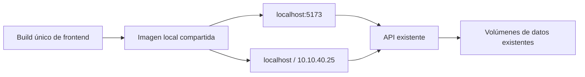

# H-65 — Navegador y sincronización local

> Código: OPS-H65-001 | Versión: 1.0 | Fecha: 2026-10-28
>
> Autor: Codex | Finalización y validación: Tech Lead

## Alcance

Login recupera bienvenida centrada en el panel de olas con Fraunces e Inter. Los filtros de tickets (escritorio y sheet móvil) y equipo comparten DatePicker con Popover y react-day-picker; se conservan valores YYYY-MM-DD, callbacks, URLs y reglas de rango. No cambian backend, contratos, permisos ni reglas de negocio.

Desde H-65.1 el calendario mantiene un borrador local: seleccionar un día no escribe la URL ni el filtro del padre. Solo Aplicar o Borrar fecha confirman el cambio; Cerrar, Escape o clic fuera descartan el borrador. El DatePicker está memoizado y su onSelect es estable, y List.tsx ignora navegaciones a una URL idéntica, de modo que un ciclo URL → render → URL no puede repetirse.

H-65.2 sustituye los `<select>` nativos de mes y año por el listbox tematizado de la aplicación: fondo de popover, texto legible en claro y oscuro, navegación por teclado y sin scrollbar del sistema. El panel usa bg-card/95 con backdrop-blur, rounded-2xl y shadow-2xl; los días de la semana se muestran en mayúsculas pequeñas y el día seleccionado es un círculo con el color primario. Sin límites externos el rango es 2000–(año actual + 10) para que el listbox de años no supere ~40 filas. El Popover ignora clics, foco y Escape dentro del portal del listbox, de modo que elegir una opción no cierra el calendario.

El layout autenticado solicita permiso de notificaciones al primer clic confiable, únicamente cuando el permiso es default, hay contexto seguro y soporte; iOS requiere instalación. Guarda un intento por origen para no insistir tras descartarlo. La campana no contiene Activar Push. Los avisos nativos proceden de una única suscripción a eventos SignalR y se muestran mediante el Service Worker registrado.

## Límites de la plataforma

El SW generado en producción importa custom-sw.js; el cliente virtual de vite-plugin-pwa registra ese único worker y activa la política autoUpdate ya configurada. Nginx obliga a revalidar sw.js, custom-sw.js, registerSW.js y el manifiesto; los bundles con hash conservan caché immutable.

HTTP localhost es un contexto potencialmente confiable; HTTP 10.10.40.25 no habilita Service Workers ni notificaciones nativas. La interfaz y las notificaciones dentro de la aplicación siguen disponibles por LAN. El backend actual usa SignalR; no tiene VAPID, suscripciones Web Push ni envío cuando la aplicación está cerrada. Este cambio de navegador no incorpora esa infraestructura.

Fuentes primarias: [MDN Notifications](https://developer.mozilla.org/en-US/docs/Web/API/Notifications_API/Using_the_Notifications_API), [Vite PWA autoUpdate](https://vite-pwa-org.netlify.app/guide/auto-update.html), [DayPicker](https://daypicker.dev/v9/docs/styling).

## Fuente única de despliegue

El problema provenía de Vite montando el checkout original mientras LAN servía un build copiado independiente. El overlay docker-compose.local-sync.yml ahora asigna la misma imagen glpi-ticket-manager-frontend:local a glpi-frontend (127.0.0.1:5173) y glpi-lan-frontend (puerto80). Ambos usan la misma API y bases de datos existentes.

scripts/sync-local-frontend.ps1 reemplaza únicamente el antiguo contenedor LAN standalone, fija el proyecto sistemaopensourceglpi y ejecuta compose down y up -d --build. No usa --volumes ni --remove-orphans. Conserva sistemaopensourceglpi_glpi-db-data, sistemaopensourceglpi_app-db-data y los volúmenes GLPI. docker-compose.prod.yml es otro stack y no se utiliza en esta entrega.

## Evidencia de ejecución

- Typecheck y build local: aprobados. Build Docker de API y frontend: aprobado.
- compose down y up -d --build: ejecutados; volúmenes originales preservados.
- curl descargó el mismo /assets/index-nAWCthTl.js desde localhost, localhost:5173 y 10.10.40.25 (build H-65.2).
- SHA256 idéntico: ab56ca746b6b040adde4e187dec271b56b5951731d856531b33193d58e28b694.
- nginx -t: aprobado en ambos contenedores; scripts SW responden Cache-Control no-cache.
- Diagnóstico cola previo al seed de la suite: HTTP200 y ticket1002 visible para tech1/lider_dev en Desarrollo; sin errores500/429 asociados. No se añadieron tickets para ocultar un problema. La suite restablece sus fixtures reservadas mediante el seed habitual.
- Los contextos de build excluyen .auth, .env, dependencias y artefactos QA locales.
- Playwright 40/40 aprobado (6,5 min, exit 0) contra el contenedor servido en localhost:5173.
- Corrección del listado: `List.tsx` usaba `data?.items ?? []`, un array nuevo por render que reactivaba `autoResetPageIndex` de TanStack Table durante la carga y bloqueaba la navegación al elegir fecha. Se sustituyó por una constante `EMPTY_TICKETS` a nivel de módulo; `typecheck`, `build` y la suite completa vuelven a pasar.
- Comprobación visual: filtro de fecha aplicado navega a /tickets?startDate=2026-10-15 y reduce el listado.
- H-65.1: `date-filter.spec.ts --repeat-each=5` → 25/25 en verde (5 ejecuciones de cada uno de los 5 tests). Aplicar escribe la URL en ~120 ms; 5 ciclos abrir/seleccionar/aplicar consecutivos sin bloqueo ni errores de página.
- Suite completa con `--repeat-each=5`: 193/205. Los 12 fallos restantes están en kanban-flow, realtime-reopen y self-assign-flow, que esperan fixtures fijos (#11, #70, #57) ya consumidos por la repetición anterior; ninguna ejecución de date-filter falló. La estabilidad global se valida con pasadas completas consecutivas sobre un seed limpio.
- H-65.2: `date-filter.spec.ts --repeat-each=5` → 25/25 en verde contra el build desplegado (listbox tematizado). Suite completa en 5 pasadas consecutivas con seed limpio por invocación: 41/41 en cada una (4,6–5,3 min), exit 0 en las cinco. Dropdown de mes/año legible en claro y oscuro, sin scrollbar nativa; día seleccionado circular y días de otro mes atenuados.

Capturas de esta entrega: docs/qa/evidence/H65/login.png, datepicker-light.png, datepicker-dark.png y notifications.png. H-65.1: docs/qa/evidence/H65.1/datepicker-selected.png, datepicker-applied.png y datepicker-light.png. H-65.2: docs/qa/evidence/H65.2/datepicker-light.png, datepicker-light-dropdown.png, datepicker-dark-dropdown.png, datepicker-dark-selected.png y datepicker-applied.png.
