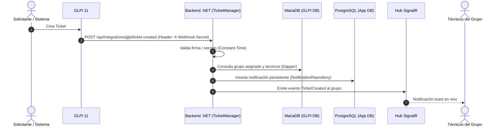

# Configuración del Webhook de Creación de Tickets en GLPI 11

Este documento detalla la configuración del Webhook en GLPI 11 para emitir notificaciones automáticas (persistentes y en tiempo real) a los técnicos del grupo de soporte asignado cuando entra un nuevo ticket.

---

## 1. Arquitectura del Flujo



---

## 2. Endpoint del Backend

- **URL**: `POST /api/integrations/glpi/ticket-created`
- **Autenticación**: Cabecera secreta compartida (`X-Webhook-Secret`, `X-Glpi-Secret`, `X-Glpi-Signature` o `Authorization: Bearer <secret>`).
- **Content-Type**: `application/json`

### Variables de Entorno del Backend
En el archivo de configuración (`appsettings.json`, `.env` o variables de contenedor Docker):

```json
{
  "GlpiWebhook": {
    "Secret": "glpi-webhook-secret-token-32-chars-minimum!!"
  }
}
```

O en Docker Compose:
```yaml
environment:
  - GlpiWebhook__Secret=glpi-webhook-secret-token-32-chars-minimum!!
```

---

## 3. Configuración en la Interfaz de GLPI 11

### Opción A: A través de Webhooks Nativos / Plugin Webhook en GLPI 11

1. Iniciar sesión en GLPI con perfil **Super-Admin**.
2. Ir a **Configuración** (Setup) > **Notificaciones** (Notifications).
3. Asegurarse de que el modo de notificaciones esté activado.
4. Navegar a **Webhooks** (o la sección de Webhooks proporcionada por la integración de GLPI):
   - **Nombre**: `Ticket Manager - Nuevo Ticket Creado`
   - **Activo**: `Sí`
   - **Tipo de elemento**: `Ticket`
   - **Evento**: `Nuevo elemento` (New item / Ticket creation)
   - **URL de destino**: `http://glpi-backend:8080/api/integrations/glpi/ticket-created` (usar `https://...` en entornos de producción).
   - **Método HTTP**: `POST`
   - **Encabezados personalizados**:
     ```http
     X-Webhook-Secret: glpi-webhook-secret-token-32-chars-minimum!!
     Content-Type: application/json
     ```
   - **Cuerpo del Webhook (Payload JSON)**:
     ```json
     {
       "ticketId": "[TICKET.ID]"
     }
     ```
     *(Nota: si el plugin de GLPI utiliza tags estilo `##ticket.id##`, usar `{"ticketId": ##ticket.id##}` o el estándar `{"items_id": ##ticket.id##}`).*

### Opción B: A través de Reglas de Negocio con Acción Webhook

1. Ir a **Administración** > **Reglas** > **Reglas de negocio para los tickets**.
2. Añadir una nueva regla:
   - **Criterio**: Estado es `Nuevo` o Grupo asignado no está vacío.
   - **Acción**: Ejecutar Webhook / Enviar HTTP POST a `/api/integrations/glpi/ticket-created`.
3. Guardar la regla y verificar su prioridad para ejecutarse después de que el grupo haya sido asignado (por reglas automáticas de asignación).

---

## 4. Pruebas y Verificación

### Prueba manual con `curl`

Para simular el envío del webhook desde la terminal:

```bash
curl -X POST http://localhost:8080/api/integrations/glpi/ticket-created \
  -H "Content-Type: application/json" \
  -H "X-Webhook-Secret: glpi-webhook-secret-token-32-chars-minimum!!" \
  -d '{"ticketId": 11}'
```

**Respuesta esperada (200 OK):**
```json
{
  "success": true,
  "ticketId": 11,
  "groupId": 1,
  "notifiedCount": 2
}
```

### Verificación en la Interfaz de la Aplicación
1. Iniciar sesión en el frontend web con un técnico perteneciente al grupo asignado (ej. `tech1`).
2. Comprobar que:
   - La campana de notificaciones incrementa el contador de pendientes.
   - Aparece la nueva notificación: *"Nuevo ticket #11 - Se ha asignado el ticket '...' a tu grupo."*
   - Si el técnico está en la pantalla activa, recibe el aviso en tiempo real vía SignalR.

---

## 5. Resolución de Problemas (Troubleshooting)

| Síntoma | Causa Probable | Solución |
|---|---|---|
| **401 Unauthorized** | El header `X-Webhook-Secret` no coincide con `GlpiWebhook:Secret`. | Verificar que el valor del header y la variable de entorno sean idénticos. |
| **400 Bad Request** | El cuerpo del payload no contiene `ticketId` o `items_id`. | Revisar la plantilla JSON en GLPI para asegurarse de que el tag de ID sea sustituido. |
| **200 OK con notified: 0** | El ticket aún no tiene grupo asignado en `glpi_groups_tickets`. | Configurar la regla de GLPI para que se dispare después de la asignación del grupo técnico. |
