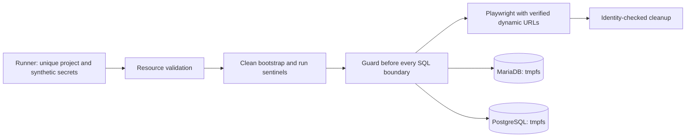

# Disposable E2E fixture (H-20)

Run from the repository root with `node scripts/e2e/run.mjs`, or use
`pnpm --dir frontend test`. Docker Desktop/Linux Docker, the declared frontend
dependencies and a Playwright Chromium installation are prerequisites.
`node scripts/e2e/run.mjs --check` validates Compose without starting containers.
Arguments after `--` select Playwright specs, for example
`node scripts/e2e/run.mjs -- date-filter.spec.ts`.
The default retains CI's API-based requester journey. Add `--native-glpi` before
`--` to provision the visual forms and exercise native GLPI submission instead.

The runner creates a random Compose project using **only**
`docker-compose.e2e.yml` and a temporary environment file. It generates database,
JWT, webhook and GLPI API secrets; it never reads the repository `.env` or imports
the legacy GLPI database dump. GLPI is installed cleanly. PostgreSQL uses the
explicit compatible migrations 001–006; SQL007 is a MariaDB script and is not
executed here. This does not fix the production migration defects H-04/H-06.

All data mounts are tmpfs. Database ports are unpublished; browser/API ports bind
to loopback with Docker-assigned ports. No existing stack is stopped or reused.
The temporary manifest records the Docker context, run ID, container IDs and
effective URLs. Before SQL, the guard checks those identities, service/network
labels, network membership, mount types, port bindings, expiry and both database
sentinels. `CI=true` never grants permission. Missing Docker or a failed check is
fatal. SQL is passed through stdin and passwords through child-process environment.



Direct `playwright test`, `scripts/seed-e2e.sh`, visual seeds and the audit smoke
script reject execution without the verified fixture. A manifest is an accidental
targeting safeguard, not an authorization boundary against someone controlling
the host/Docker daemon. Do not copy it to another environment or publish it: it
contains temporary synthetic credentials.

Safe tests without Docker/browser:

```sh
node --test scripts/e2e/*.test.mjs
pnpm --dir frontend typecheck
```

The entrypoint regression tests require the declared frontend TypeScript package.
CI installs it before those tests. Traces are disabled because they embed
authorization headers; screenshots/video and reports are retained for seven days
in CI. Never supply real personal data or production credentials to the fixture.
Each run stores reports under `frontend/e2e-artifacts/<runId>/`, preserving prior
results. The sibling `auth/` directory contains temporary fixture JWTs and is
excluded from CI uploads. Do not publish it.

Rollback: disable the E2E job/runner while investigating. Do not restore the old
unconditional reset against named local containers. This PR changes test tooling;
it does not change application permissions, production deployment or database data.
