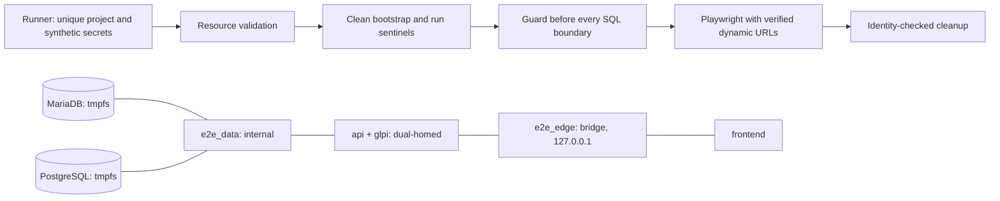

# Disposable E2E fixture (H-20)

Run from the repository root with `node scripts/e2e/run.mjs`, or use
`pnpm --dir frontend test`. Docker Desktop/Linux Docker, the declared frontend
dependencies and a Playwright Chromium installation are prerequisites.
`node scripts/e2e/run.mjs --check` validates Compose without starting containers.
Arguments after `--` select Playwright specs, for example
`node scripts/e2e/run.mjs -- date-filter.spec.ts`.
The default retains CI's API-based requester journey. Add `--native-glpi` before
`--` to provision the visual forms and exercise native GLPI submission instead.

The runner creates a random Compose project using **only**
`docker-compose.e2e.yml` and a temporary environment file. It generates database,
JWT, webhook and GLPI API secrets; it never reads the repository `.env` or imports
the legacy GLPI database dump. GLPI is installed cleanly. PostgreSQL uses the
explicit compatible migrations 001–006; SQL007 is a MariaDB script and is not
executed here. This does not fix the production migration defects H-04/H-06.

All data mounts are tmpfs. Database ports are unpublished; browser/API ports bind
to loopback with Docker-assigned ports. Host ports reserved by the development or
acceptance stacks (5173, 8080, 8081, 3306, 5432, 80, 443, 3000) are rejected in the
manifest.

Each run owns **two** dedicated networks:

- `e2e_data` — `internal: true`. Databases only, plus the services that must reach
  them (`glpi`, `api`). It has no gateway, so Docker Desktop cannot and does not
  create a host binding for anything on it. This is also why the databases are
  never published: publishing a port on an internal network silently produces no
  effective binding on Docker Desktop, which is the failure the previous
  single-network design worked around by removing `internal` entirely.
- `e2e_edge` — a conventional `bridge` network for `frontend`, `api` and `glpi`,
  published on `127.0.0.1` with Docker-assigned ports. It must not be `internal`,
  or the fixture would be unreachable from the runner.

`glpi` and `api` join both networks (they need the databases and the published
edge); `glpi-db`/`app-db` join only `e2e_data` and `frontend` joins only
`e2e_edge`. The guard rejects a single shared network, a third network, a database
on the edge network, a frontend on the data network, an internal edge network, a
public data network, any foreign member and any effective database port. No other
stack is ever attached or reused, and no existing stack is stopped.

The temporary manifest records the Docker context, run ID, container IDs and
effective URLs. Before SQL, the guard checks those identities, service/network
labels, membership by role, both network identities and drivers, mount types, port
bindings, expiry and both database sentinels (including the expected database
name). `CI=true` never grants permission.

The fixture API keeps both rate limiters enabled but uses budgets sized for the
whole suite (600 requests/min and a 200-token bucket refilled every second). The
suite runs every spec as one synthetic user behind one proxy IP, so production
budgets (100/min, 20 tokens every 3s) are shared across specs and background
refetches of the `Expensive` `by-group`/`stats` endpoints answer 429. These values
exist only in `docker-compose.e2e.yml`; production limits in `appsettings.json`
are untouched.

Destructive work also needs `E2E_CONFIRM_DESTRUCTIVE` set to the manifest `runId`.
The runner sets it only for its own random fixture; a stale manifest, a copied
manifest or `CI=true` cannot authorize a reset. Missing Docker or a failed check is
fatal. SQL is passed through stdin and passwords through child-process environment.



Direct `playwright test`, `scripts/seed-e2e.sh`, visual seeds, the audit smoke
script and every legacy seed helper (`seed-glpi-users.js`, `seed-tickets.js`,
`seed-glpi-categories.js`, `verify-glpi-categories-flow.js`,
`provision-glpi-test-users.sh`) reject execution without the verified fixture and
the run-scoped destructive confirmation. The legacy helpers no longer read `.env`
or fall back to a literal database password; they execute SQL through the guard
and target the exact container ID. Dev/bootstrap seeding is intentionally not
available in this PR and must be redesigned against an explicitly identified
fixture. `seed-e2e.sql` and `seed-h38.sql` additionally abort inside MariaDB when
the `e2e_fixture_identity` sentinel is absent. A manifest is an accidental
targeting safeguard, not an authorization boundary against someone controlling
the host/Docker daemon. Do not copy it to another environment or publish it: it
contains temporary synthetic credentials.

Safe tests without Docker/browser:

```sh
node --test scripts/e2e/*.test.mjs
pnpm --dir frontend typecheck
```

The entrypoint regression tests require the declared frontend TypeScript package.
CI installs it before those tests. Traces are disabled because they embed
authorization headers; screenshots/video and reports are retained for seven days
in CI. Never supply real personal data or production credentials to the fixture.
Each run stores reports under `frontend/e2e-artifacts/<runId>/`, preserving prior
results. The sibling `auth/` directory contains temporary fixture JWTs and is
excluded from CI uploads. Do not publish it.

Fixture-only user credentials (the seeded bcrypt hashes and the `E2E_*` user
passwords provided by the runner) are synthetic and deliberately reused so the
specs stay deterministic. They are not production or dev credentials. Record them
as requiring rotation/removal before any use with real data, and never reuse them
outside the disposable fixture. Database, JWT, GLPI API and webhook secrets are
generated per run and are never printed.

Rollback: disable the E2E job/runner while investigating. Do not restore the old
unconditional reset against named local containers. This PR changes test tooling;
it does not change application permissions, production deployment or database data.
